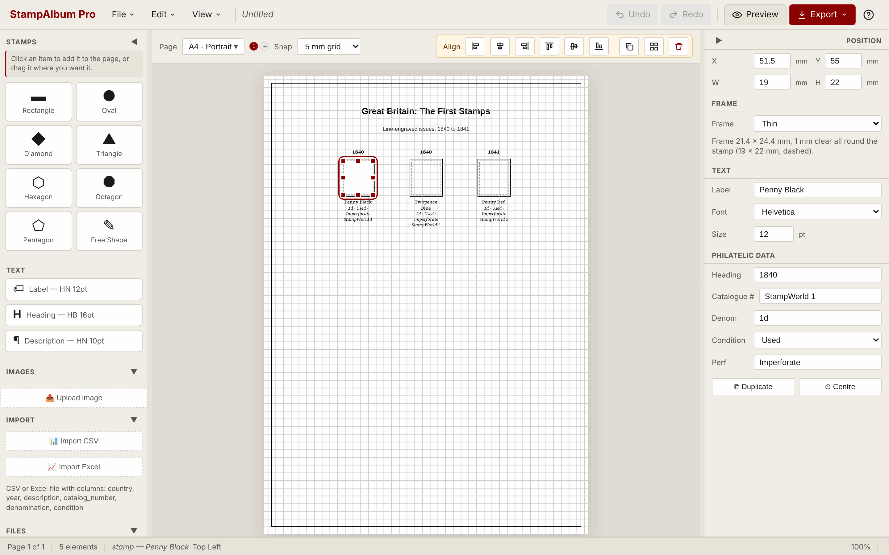
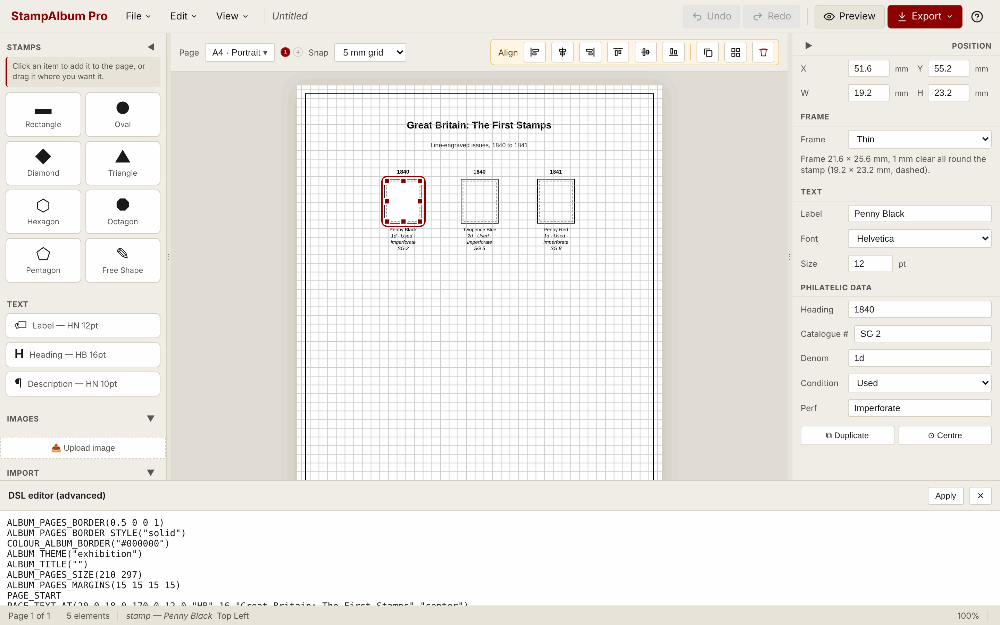

# StampAlbum Pro

Design and print stamp album pages. StampAlbum Pro pairs a drag-and-drop page canvas with a text-based page description (DSL) and exports print-ready pages.

> **Status: alpha (v0.3.0).** Developed on macOS. The automated test suite also runs on Windows and Linux in CI. Each [release](https://github.com/jsganesh/stamp-album-pro/releases) has a zipped macOS app (Apple silicon) and a zipped Windows folder; neither is signed yet. You can also run it from source (see below).



## What it does today

- **Visual canvas:** place, drag, resize and align stamps and text elements on a page
- **Stamp shapes:** rectangle, triangle, diamond, oval, hexagon, octagon, pentagon
- **Stamp frames:** None, Thin, Medium or Double, always black. You enter the stamp's own size from the catalogue; the frame is drawn 1 mm clear all round it
- **Captions:** a heading above each stamp; description, details and catalogue number below, set in the bundled Source Serif 4 Caption so they wrap the same way in the editor and every export
- **Themes and page borders:** plain borders for exhibition pages and decorative ones (corner ornaments, Greek key, Rope) for personal albums, in the theme's colour
- **Pages:** add and delete pages; page sizes include A5 and Legal
- **Layout tools:** grid fill and undo/redo
- **Images:** upload and place images on a page
- **Starter templates:** four exhibition-style pages in the wizard's Template Gallery: Single stamp, Set row, Title page and Exhibition page
- **DSL mode:** an advanced text view of the same page, for precise or bulk editing
- **Export:** PDF, PNG and SVG
- **Print calibration page:** a PDF with rulers, a measured square and sample frames, to check your printer prints 1 mm as 1 mm (File › Print calibration page…)
- **Album files:** create, open, save and delete `.slbum` albums from the sidebar



The tutorial pictures and these screenshots are made from the running app with `make screenshots` (`tools/screenshots.py`); run it after changing how the editor looks.

## What it does not do yet

- **No exhibition-rule checking.** The goal is pages that meet international exhibition standards, but this release does not verify compliance with any federation's rules. Check your pages against the current regulations yourself.
- **No signed installers.** `make app` builds a macOS app, and CI builds a zipped Windows folder (see [docs/BUILD.md](docs/BUILD.md)), but neither is signed, so macOS and Windows warn the first time it is opened.

## Run from source

Requirements: Python 3.10 or newer (CI tests 3.10, 3.11 and 3.13) and [uv](https://docs.astral.sh/uv/).

```bash
git clone https://github.com/jsganesh/stamp-album-pro.git
cd stamp-album-pro
uv sync --extra dev

uv run stamp-album             # starts the app at http://127.0.0.1:8080 and opens your browser
uv run stamp-album --desktop   # the same app in a native window (pywebview)
```

Other modes: `--web` (browser mode, explicit) and `--dev` (auto-reload while developing).

Headless PDF generation from a DSL file: `uv run stamp-album -c album.slbum -o album.pdf`. Add `-p` to also write an HTML preview; `stamp-album --cli --help` lists every option.

Without uv: `python -m venv .venv`, activate it, then `pip install -e ".[dev]"`.

Platform notes:
- **macOS:** the main development platform.
- **Windows:** tests pass in CI; the app itself has not been checked there yet.
- **Linux:** tests pass in CI on Ubuntu; the app itself is not verified.

The `launcher/` folder contains launch scripts (a `.command` file for macOS, a `.bat` file for Windows, a `.desktop` file for Linux; see `launcher/README.md`). They have not been tested for 0.3.0.

## Development

```bash
make test                    # pytest on src/tests
uv run ruff check src        # lint (CI fails on any finding)
```

CI runs the tests on macOS, Windows and Ubuntu from the locked dependencies in `uv.lock`. It also builds the wheel and checks that it contains the web UI, contains no test code, and imports in a clean environment.

## Project layout

```
src/stamp_album/
  api.py        FastAPI backend (albums, templates, export)
  templates.py  starter templates for the Template Gallery
  core/         models, DSL parser, serializer
  engines/      layout and rendering (HTML preview, PDF, PNG, SVG)
  web/          browser UI (HTML, JS, CSS)
assets/         sample album files
launcher/       launch scripts for macOS, Windows and Linux
packaging/      PyInstaller spec and a check for the built app
docs/           architecture and build notes
```

## Documentation

- [ARCHITECTURE.md](ARCHITECTURE.md): how the rendering pipeline fits together. Some sections predate the ReportLab engines.
- [docs/BUILD.md](docs/BUILD.md): building the macOS and Windows apps
- [CHANGELOG.md](CHANGELOG.md): what changed in each release

## Acknowledgements

StampAlbum Pro's page-description language follows the command syntax of **AlbumEasy**, the free stamp-album software written by Clive Levinson (Bundu Technology Ltd., [theStampWeb.com](http://www.thestampweb.com)) since 2005. AlbumEasy showed that a plain-text description could produce well-formatted album pages, and years of my own album pages were made with it. StampAlbum Pro reads AlbumEasy-style album files so that work carries forward, and keeps AlbumEasy's command names and font codes (TN, HB, …) for that reason. My thanks to Clive for the idea and for many years of AlbumEasy.

StampAlbum Pro is a separate program written from scratch in Python and JavaScript. It contains no AlbumEasy source code, artwork or fonts, and it is not affiliated with or endorsed by AlbumEasy. AlbumEasy is licensed under the GNU GPL v3.

## Licence

MIT, see [LICENSE](LICENSE).

The caption font, Source Serif 4 Caption by Adobe, is bundled under the SIL Open Font License 1.1 ([src/stamp_album/web/fonts/OFL.txt](src/stamp_album/web/fonts/OFL.txt)).

Licensing note: dependency licences have not been audited yet, so review them before distributing binaries. (v0.2.0 included PyMuPDF, which is AGPL-3.0 or commercial; it has since been removed.)
